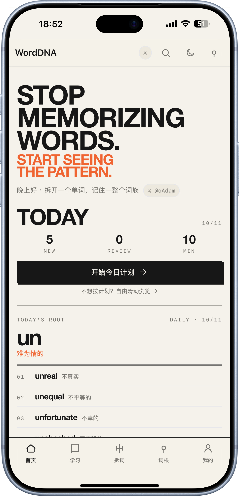
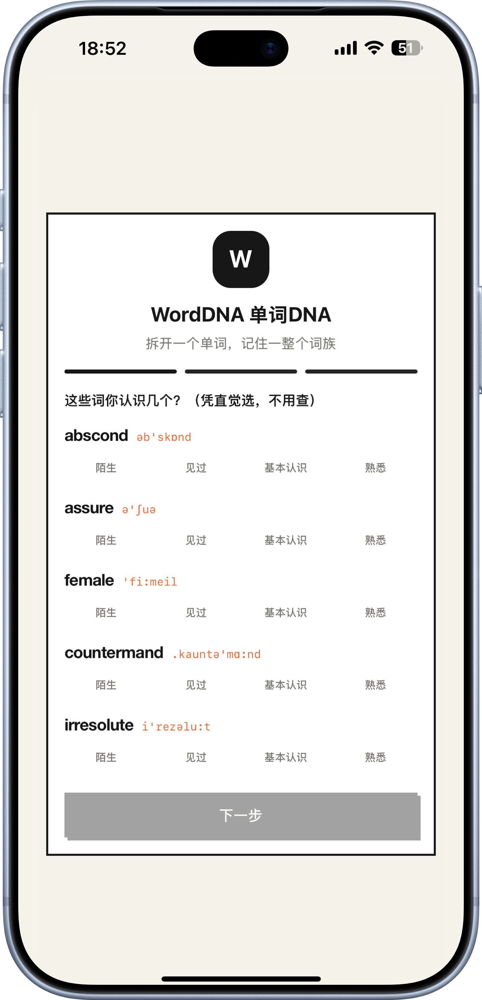
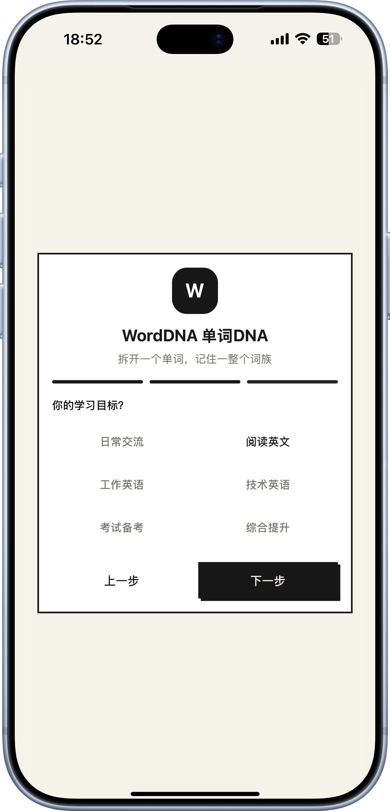
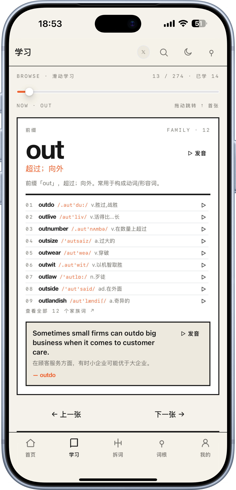
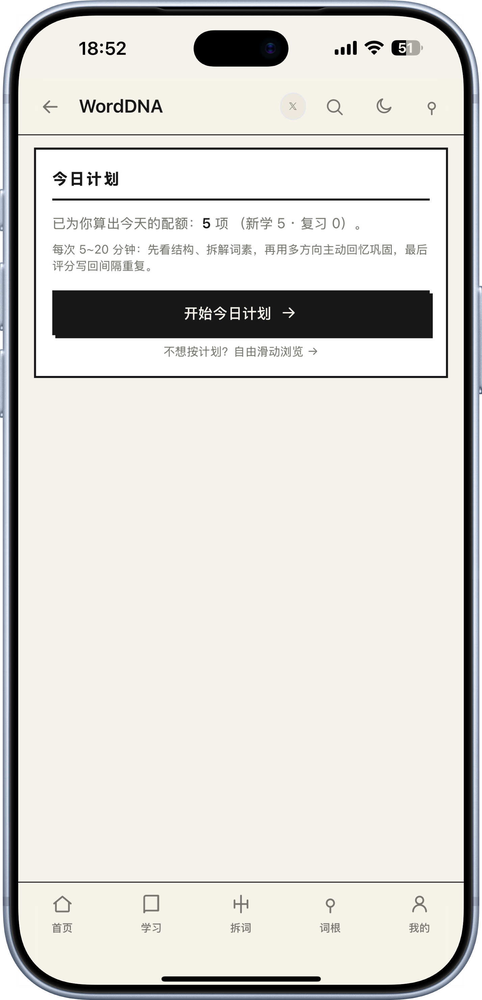
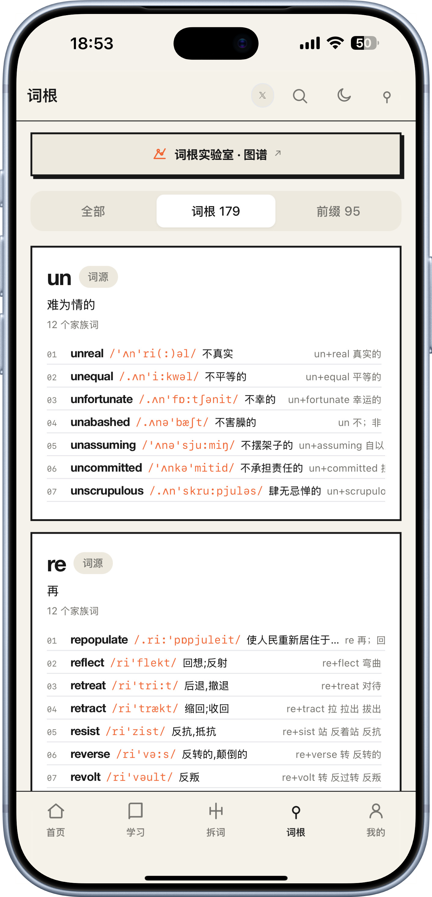
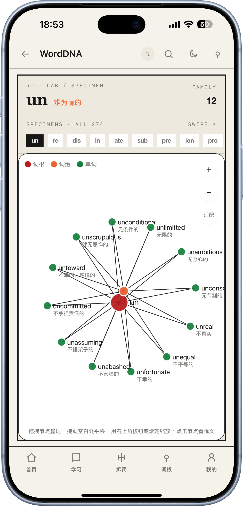
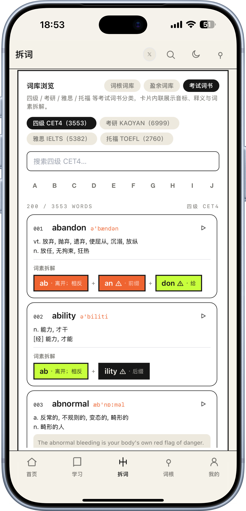
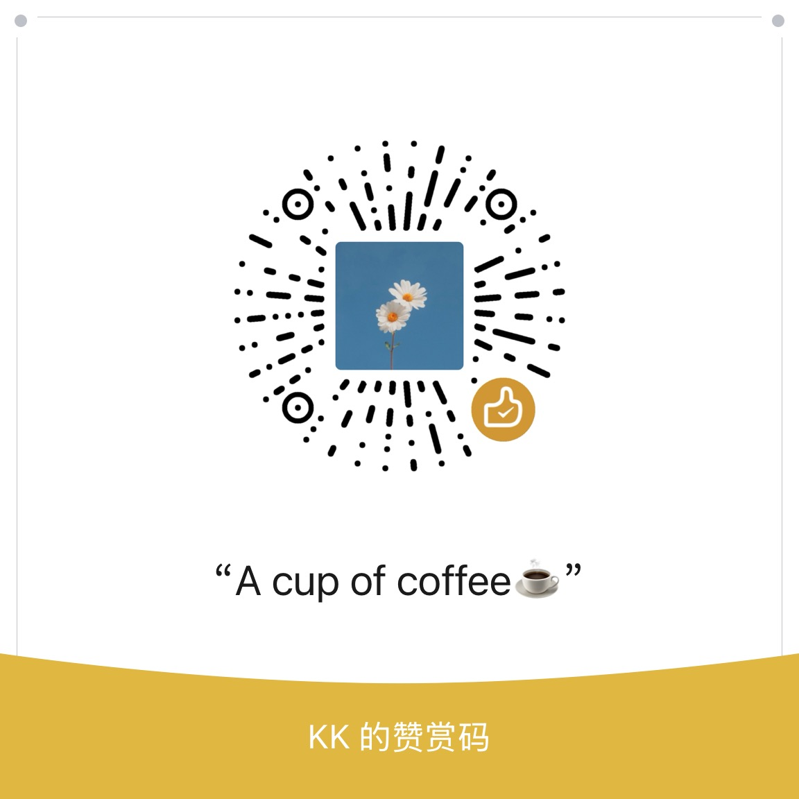

<div align="center">

# 🧬 WordDNA<sup>®</sup>

### 拆开一个单词，记住一整个词族

**STOP MEMORIZING WORDS. START SEEING THE PATTERN.**

<p>
  
  
  
  
  
  
  
</p>

<p>
  <a href="https://x.com/0xkillcoin"></a>
</p>

<p>
  <b>作者：</b> <a href="https://x.com/0xkillcoin"><b>𝕏 @oAdam</b></a> &nbsp;·&nbsp; <b>VOL.001 · ROOT LAB</b>
</p>

<p>
  <a href="https://WordDNA.321.market/"></a>
</p>

<p>
  <b>🌐 在线体验（无需安装，PWA 可装到主屏）：</b> <a href="https://WordDNA.321.market/"><b>https://WordDNA.321.market/</b></a>
</p>

</div>

---

## 为什么是 WordDNA

背单词最大的谎言，是「一个单词 = 一条记忆」。

真实情况是：英语词汇是一张**有 DNA 的网**。`un-` 是否定，`-able` 是「能够」，`spect` 是「看」——
你以为你要背的是 `inspect / respect / retrospect / spectacle / spectator` 五个词，
其实你只需要搞懂 **1 个词根**，那 5 个词会自己长出来。

WordDNA 就是干这件事的：**把单词拆开给你看，让你一次记住一整个词族。**

> 不是词典，不是单词卡，是一个**词根实验室**。

<div align="center">

| 传统背单词 | WordDNA |
| :--- | :--- |
| 一个词一条记忆，3000 词 = 3000 条 | 274 个词根，串起整张词网 |
| 今天背明天忘，全靠重复 | 先看结构 → 理解 → 再用 SRS 巩固 |
| 单词是孤立符号 | 单词是 `前缀 + 词根 + 后缀` 的可拆装零件 |
| 学到哪全凭 App 心情 | 实时掌握度、到期复习、错词归因到词根 |

</div>

---

## ✨ 功能全景

### 🏠 首页 · 今日作战台

<div align="center">
  
  <p><sub>首页 · 今日作战台（移动端自适应）</sub></p>
</div>

- **TODAY'S ROOT** — 每天轮换一个词根，标注日期，当天固定；下面直接列出它的家族词，点开即学。
- **RECOMMENDED** — 推荐词根，可手洗牌；**洗完固定住**，返回再进不会变。
- **WEAK ROOTS** — 薄弱环节。不只统计答错次数，还融合 SRS 的 `lapses`（遗忘次数）与 `ease`（难度系数），把「你真正搞不定的词根」挑出来。
- **MASTERY / STREAK / ROOTS / WORDS** 四格编辑部式数据条，一眼看清进度。
- **首次诊断（Onboarding）** — 新用户先过 3 步：① 5 个样例词自评熟悉度（陌生 / 见过 / 知道 / 熟）② 选目标（日常 / 阅读 / 工作 / 技术 / 考试 / 全面）③ 选每日时长（5 / 10 / 20 / 30 分钟）。系统据此推断水平档（weak / mid / strong），后续推荐与计划都围绕它。

<div align="center">
  <table>
    <tr>
      <td></td>
      <td></td>
    </tr>
  </table>
  <p><sub>首次诊断：① 自评熟悉度　② 选择学习目标与时长</sub></p>
</div>

- **TODAY · 今日计划** — 进首页直接看到「今天学几个新词 / 复习几个 / 约几分钟」三格目标，以及「开始今日计划」入口，不用自己想「今天学什么」。
- **欢迎回来** — 隔了 ≥1 天再打开，给一张无压力的「WELCOME BACK」卡片，只告诉你上次学到哪、今天该捡起什么，不甩 guilt。

### 📖 学习 · 滑动式词族流

<div align="center">
  
  <p><sub>滑动式词族流：一张卡 = 一个词根 + 一整个词族</sub></p>
</div>

- **一张卡 = 一个词根 + 它的一整个词族**，左右滑动连续吸收，**不强制立刻测试**。
- 家族词列表默认露出 8 行，每行带 `单词 + 音标 + 释义`，行高压紧、信息密度拉满；更多可上下滚动。
- 底部自动挂一个**真实例句**（脱离语境背单词留存率极低），可点读。
- **顶部进度条可拖动**：274 张卡不用再狂点「上一张」，拖动即跳转，还有 `⤒ 首张` 一键回到开头。
- 从任意单词点「学这个词族」，会**精确停在它的词根上并高亮那个词**——`unequal` 一定落在 `un`，不会跳到别处。

### 🎯 主动回忆 · 多方向测试
- 点「开始测试」只会考**已经浏览过**的内容，且优先考最久没复习的，避免刚看完立刻考。
- 五方向主动回忆，覆盖「识别 → 回忆 → 词缀 → 语境 → 辨析」：
  - **识别**：给词 / 根文本 → 选释义（Recognition）
  - **反向回忆**：给中文释义 → 选词形（Recall，比识别更难、留存更好）
  - **词缀回忆**：给前缀 / 后缀 → 选释义（Affix）
  - **语境理解**：给真实例句 → 选该词在句中的释义（Context，脱离语境背单词留存低）
  - **词义辨析**：同一词根的词族里，挑出某个特定意思（Distinguish，同一词根 ≠ 相同意思）
- 每题答完即时反馈：答对 / 答错标红，并补一条**真实例句**做 elaborative feedback（研究表明「对答案 + 看语境」比只告知对错更有效）；答错的自动进错题本，并在更短间隔后再考你。

### 🗓 每日计划 · 引导式会话

<div align="center">
  
  <p><sub>每日计划引导式会话</sub></p>
</div>

- 首页 TODAY 卡片的「开始今日计划」入口，把「今天该学什么」直接排成一条引导路线，**不取代**原有的滑动流（底部「学习」仍是自由滑动，TODAY 卡片下也有「自由滑动浏览」入口）。
- 一条条目走四步：① **理解**（看词根 / 单词 + 词族与释义）② **拆解**（看一个样本词的词素零件：前缀 / 词根 / 后缀）③ **回忆**（多方向主动回忆题：识别 / 反向回忆 / 词缀 / 语境 / 辨析）④ **评分**（Again / Hard / Good / Easy 写回间隔重复）。
- 配额由 `buildDailyQueue` 按每日时长算出（新学 N + 复习 M），到期复习优先；会话开始即快照队列，评分改写 SRS 也不会让进度错位。
- 会话结束自动记到「我的」每日学习数与正确率，第二天按遗忘曲线再提醒你。

### 🧪 拆词 · 词素手术台
- 输入任意单词，切成 `前缀 / 词根 / 后缀` 的彩色零件，每个零件给中文义。
- 拆完之后可以直接「学这个词族」，把拆解结果接进学习流。

### 🌳 词根 · 实验室与图谱
- 274 个词根（**179 词源 + 95 前缀**），按分类/字母筛选，分类与滚动位置都会记住。
- **RootCard 不留白**：左侧巨型词根，右侧直接摊开家族词 —— `单词 音标 释义 词素拆解`，词多字号自动收紧、超出可滚动。

<div align="center">
  
  <p><sub>词根实验室：274 个词根，分类/字母筛选，家族词直接摊开</sub></p>
</div>

- **词根图谱（Graph）**：力导向图看词根与单词的关系网络，点节点直接跳详情；配色沿用编辑部色板，深色下也读得清。

<div align="center">
  
  <p><sub>词根图谱：力导向关系网络，点节点跳详情</sub></p>
</div>

### 📚 词库浏览

<div align="center">
  
  <p><sub>词库浏览：分页加载 + 进度记忆 + 发音按钮</sub></p>
</div>

- **词根词库 / 盈余词库 / 考试词书** 三个分区，每词带淡淡的序号（001、002…），知道自己在第几个。
- 每个词卡都有**发音按钮**（Web Speech API，可调音色与语速）。
- **分页加载**：默认 200 条，可「加载更多」，并且**记住你看到第几页**——刷新后从原地继续。
- 考试词书覆盖 CET4 / 考研 / 雅思 / 托福。

### 🧠 SRS 间隔重复
- 自研调度：间隔阶梯 `10分钟 → 1/3/7/14/30/90天`，ease 动态浮动（1.3 ~ 3.0）。
- 4 档评分（Again / Hard / Good / Easy），`repetitions ≥ 4` 且间隔 ≥ 30 天判定**已掌握**。
- 到期队列自动排入复习，状态加权：`已掌握 100% / 复习中 70% / 学习中 40% / 未接触不计入`。

### 📊 我的 · 数据与掌握度
- 掌握度总览、连续学习天数、词根掌握排行、学习曲线（自绘 SVG，无图表库）。
- 错题本可按词根归因，**支持一键清空**。
- 掌握度怎么算的，页面上直接写明公式，不藏黑箱。
- **数据备份（设置页）** — 一键「导出数据」下载 JSON（含设置、SRS 进度、收藏、错题），换设备或清缓存前先备份；「导入数据」可整包恢复。全部本地，不上传服务器。

### 📱 PWA
- 可添加到主屏幕，图标、启动画面、状态栏配色与 App 顶部一致（浅色/深色分别适配）。
- Service Worker 离线缓存，**断网也能学**。
- 数据落在 IndexedDB（带 localStorage 兜底），不上传任何服务器。

---

## 🚀 快速开始

```bash
# 1. 克隆
git clone https://github.com/iiiiiiiiiiiiKK/WordDNA.git
cd WordDNA

# 2. 安装依赖
npm install

# 3. 启动开发服务器
npm run dev        # http://localhost:5173

# 4. 构建 & 本地预览生产包
npm run build
npm run preview

# 5. 类型检查
npm run typecheck
```

> 需要 Node.js **18+**（推荐 20 LTS）。

---

## 📦 内置数据

全部离线打包进前端，**零后端、零 API Key、零网络请求**。

| 数据集 | 规模 | 说明 |
| :--- | ---: | :--- |
| 词根词缀 | **274** 条 | 179 词源 + 95 前缀，每条带释义、来源语言、描述 |
| 核心单词 | **927** 个 | 与词根构成 1,129 条家族关联 |
| 单词音标 | **873** 条 | 覆盖 94% 核心词 |
| 真实例句 | **740** 条 | 中英对照，可朗读 |
| 离线词典 | **15,000** 条 | 盈余词库，用于查词与补充 |
| 考试词书 | 4 本 | CET4 3,553 · 考研 6,999 · 雅思 5,382 · 托福 2,760 |

数据构建脚本在 `scripts/`（`buildEcdict.mjs` / `buildVocab.mjs` / `checkDups.mjs`），
原始数据体量过大（100MB+）不入库，构建产物已内联到 `src/data/`。

> **数据质量**：已清洗 **583 条指向不存在词根的孤儿引用**（`word.rootIds`，如 `asocial→r-social`、`abnormal→r-normal`），词族 / 薄弱词根 / 每日计划不再被幽灵词根污染；并为词根、词缀打上 `verificationStatus`（`verified` / `review`），供后续人工核验。校验脚本见 `tools/diag-orphans.ts`。

---

## 🏗 技术架构

```
WordDNA/
├── src/
│   ├── components/
│   │   ├── common/      # Button / Card / Chip / Dialog / Icon / SpeakButton …
│   │   ├── layout/      # AppShell / TopBar / Sidebar / BottomNav / RightRail
│   │   ├── learning/    # LearnFeed / Flashcard / QuizRunner / 各种题型步骤
│   │   ├── root/        # RootCard / RootList / RootFamilyList
│   │   ├── word/        # WordAnatomy / WordBuildingBoard / WordbookPanel
│   │   ├── viz/         # GraphExplorer / MasteryChart / ProgressRing …（纯 SVG 手绘）
│   │   └── search/      # SearchPanel
│   ├── pages/           # Dashboard / Study / Split / Roots / RootFamily /
│   │                    # WordDetail / Graph / Stats / Mistakes / Favorites / Settings
│   ├── lib/             # srs / quiz / queue / mastery / splitter / search /
│   │                    # theme / storage / useScrollRestore
│   ├── store/           # useLearningStore / useCollectionStore /
│   │                    # useSettingsStore / useUIStore（Zustand）
│   ├── data/            # 离线数据集（TS + JSON）
│   └── types/           # 领域模型
├── scripts/             # 数据构建与校验脚本
├── public/              # PWA manifest / service worker / 图标
└── docs/                # 文档与资源
```

**关键决策**

| 决策 | 理由 |
| :--- | :--- |
| **零 UI / 图表 / 图标库** | 图标是自绘 SVG 组件，图表是手写 SVG/CSS。包体可控，视觉完全自洽 |
| **纯前端 + IndexedDB** | 学习数据属于用户本人，不上传；断网可用 |
| **Zustand 而非 Redux** | 四个小 store，够用且没有样板代码 |
| **浏览与测试分离** | 先滑着看、理解了，再主动点「开始测试」；只考浏览过的内容，不拿刚看的题考你 |
| **SRS 用纯函数实现** | `src/lib/srs.ts` 无副作用、可单测、可替换为别的调度算法 |

---

## 🎨 设计系统

一套「**编辑部 / 实验室**」风格的排版语言：巨型标题、等宽标签、粗黑分隔线、硬阴影。

| Token | 值 | 用途 |
| :--- | :--- | :--- |
| `Paper` | `#F5F2EA` | 纸感背景 |
| `Ink` | `#171717` | 主文字 / 描边 |
| `Acid` | `#C8FF3D` | 荧光高亮（唯一强调色） |
| `Flame` | `#F06432` | 次级强调（音标、链接、滑块） |
| `Muted` | `#77756F` | 次要信息 |
| `Dark BG` | `#0E0E0C` | 深色模式底 |

深色模式不是简单反色，而是整套语义变量切换（`--ink` / `--paper` / `--btn-bg` / `--btn-fg`），
保证任何面板、按钮、**iOS 状态栏**在任何主题下都读得清。

---

## 🗺 路线图

- [x] 词根驱动的学习流与词族展示
- [x] 自研 SRS 与掌握度模型
- [x] 词根图谱可视化
- [x] 词库浏览、分页与进度记忆
- [x] PWA 离线与 iOS 状态栏适配
- [x] 首次诊断 + 欢迎回来 + 今日计划（首页聚焦该学什么）
- [x] 主动回忆多方向（识别 / 反向回忆 / 词缀 / 语境 / 辨析）+ 词义辨析
- [x] 学习数据导出 / 导入（本地 JSON 备份）
- [x] 每日计划引导式会话（理解 → 拆解 → 回忆 → 评分，复用 buildDailyQueue / buildQuiz）
- [x] 词根 / 词缀数据校验清洗（剔除 583 孤儿 rootId + verificationStatus 字段）
- [ ] 拼写/听写题型（当前已有选择题、回忆题）
- [ ] 自定义词单导入
- [ ] 跨设备同步
- [ ] 词根发音与词源故事音频化
- [ ] 更多考试词书（GRE / SAT / 职场高频）

---

## ☕ 请作者喝杯咖啡

如果这个仓库对你有用，欢迎打赏支持 —— 它会变成更多词根、更多例句和更好的界面。

<div align="center">



<sub>扫码打赏 · 感谢每一份支持 🙏</sub>

</div>

---

## 🔗 联系

<div align="center">

**𝕏 <a href="https://x.com/0xkillcoin">@oAdam</a>**

有问题、想法或 bug，欢迎在 X 上直接找我，或在本仓库开 Issue / PR。

</div>

---

## 📄 开源协议

基于 **MIT License** 开源 —— 自由使用、修改、商用，只需保留署名。

<div align="center">

**WORDDNA<sup>®</sup> · ROOT LAB · VOL.001**

*拆开一个单词，记住一整个词族。*

</div>
